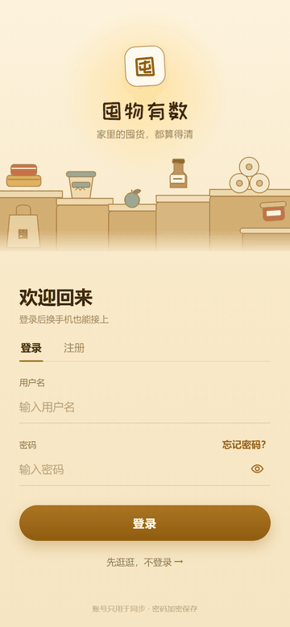
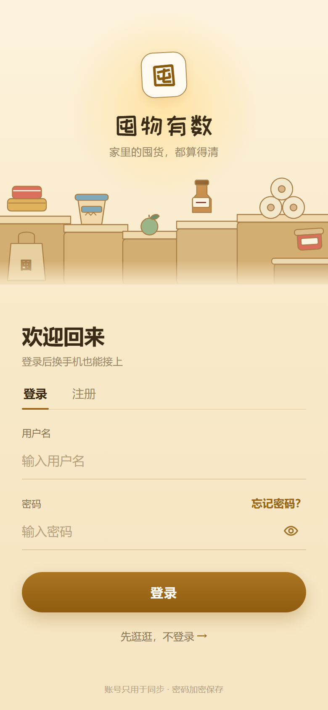
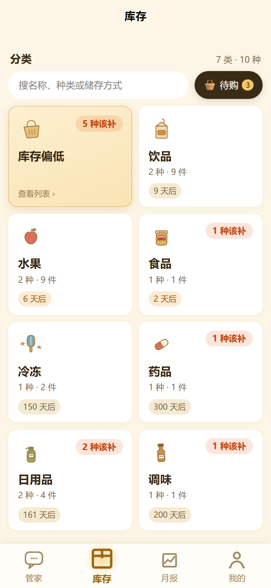
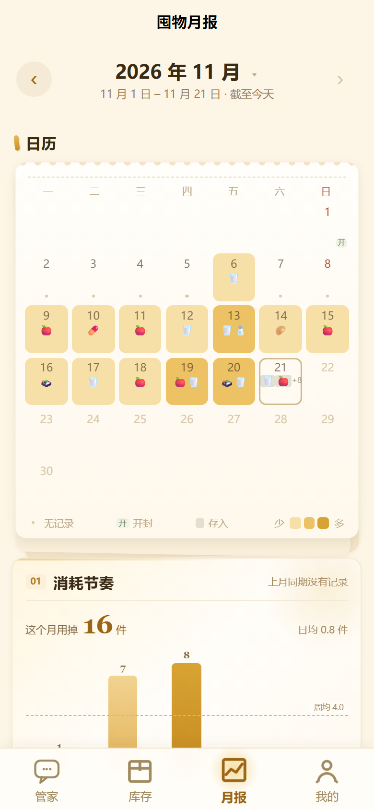
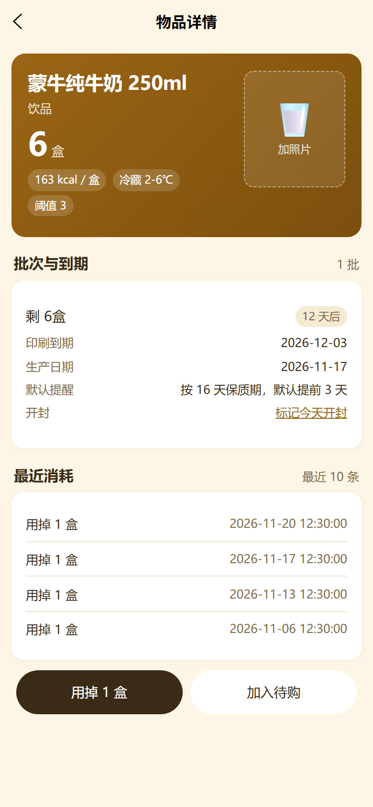
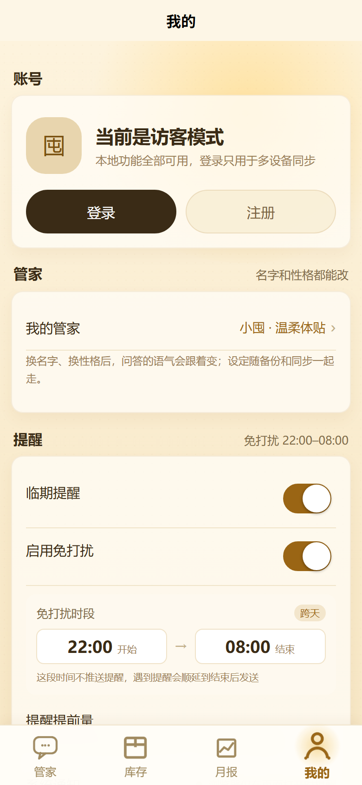
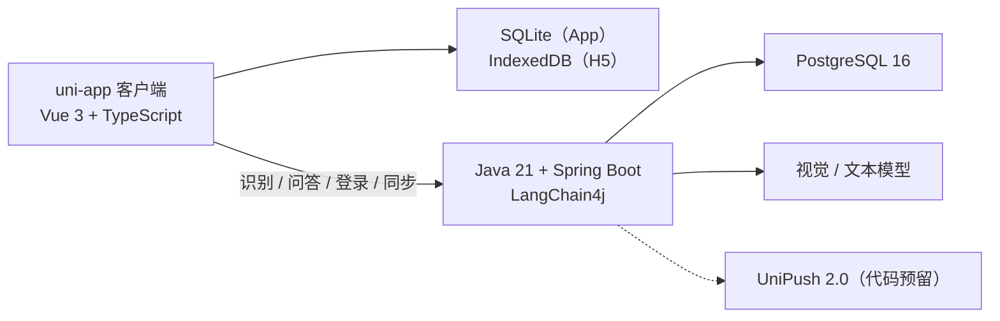

# 囤物有数 · Tunwu Youshu

> 本地优先的宿舍 / 独居物品与临期管理 App：拍照入库、库存分类、临期提醒、月报，还有一个叫「小囤」的 AI 管家。

[](https://github.com/Carys-0312/tunwu-youshu/actions/workflows/ci.yml)
[](https://github.com/Carys-0312/tunwu-youshu/releases)
[](LICENSE)

[uni-app](https://uniapp.dcloud.net.cn/) · Vue 3 · TypeScript · Pinia · Vite · Apache-2.0

App 用 uni-app（Vue 3）一套代码同时构建 **H5 与 Android**。库存、照片、批次和提醒默认只存在设备本机；只有拍照识别、AI 问答、月报润色和多设备同步需要后端。

> **本仓库只包含客户端。** 服务端（识别代理、AI 问答、账号与同步）不在此仓库中，详见下方「后端说明」。

## 项目背景

独居或住宿舍时，物品买回来很容易忘：牛奶放到过期、抽纸用完了才想起来、冰箱深处翻出半年前的速冻食品。现有备忘录要么只能记清单，要么把数据全部放在云端，断网、换设备或不想注册账号时都不好用。

「囤物有数」想做的是：

- **先能离线用**：不登录也能拍照入库、看库存、收到期提醒
- **再解决记不住**：拍照识别名称、分类、保质期，自动算到期日和提醒时间
- **需要多设备时再同步**：登录后整份快照推拉，换机不丢数据
- **AI 只做辅助**：识别和问答调用模型，但库存数据默认不离开设备，服务端也不持久化物品内容

## 演示



- **Android APK**：[下载最新版本](https://github.com/Carys-0312/tunwu-youshu/releases/latest)（Release 附件）
- **H5**：克隆后 `npm ci && npm run dev:h5`，不配置后端也能体验库存、提醒和月报
- **全部截图**：[docs/screenshots](docs/screenshots)

| 登录 | 管家 | 库存 |
| :---: | :---: | :---: |
|  |  |  |

| 月报 | 物品详情 | 我的 |
| :---: | :---: | :---: |
|  |  |  |

> 截图中的物品均为演示数据。

## 我做了什么

个人独立项目，从产品设计到上线完整走了一遍：

- **客户端**：uni-app（Vue 3 + TypeScript）实现 17 个页面，一套代码构建 H5 与 Android；暖黄色视觉、功能引导、插画与图标体系
- **本地数据层**：App 用 SQLite、H5 用 IndexedDB，共用同一套表结构、仓储接口和迁移逻辑
- **服务端**：Java 21 + Spring Boot 3.5 + LangChain4j，PostgreSQL 16，Flyway V1–V12，JWT + BCrypt 多用户鉴权
- **AI 能力**：视觉模型多图识别（正面 / 背面 / 日期特写）、文本模型管家（工具链 + 库存快照 + 人设）
- **同步与账号**：整份快照推拉、revision 机制、覆盖保护、换机 / 换账号数据归属、邮箱验证码找回密码
- **工程化**：客户端 Vitest 36 个用例、服务端 JUnit 15 个用例、GitHub Actions CI、Apache-2.0 开源
- **部署**：阿里云 ECS + Nginx + systemd + Docker PostgreSQL，H5 与 APK 双端发版

> 服务端代码不在本仓库，面试时可单独演示；客户端可独立运行全部本地功能。

## 技术亮点

- **本地优先架构**：库存、照片、批次、提醒默认只存设备；后端不可用时 App 仍能完整使用本地功能
- **双存储驱动**：SQLite 与 IndexedDB 共用一套仓储接口，业务代码不感知运行端
- **整份快照同步**：按账号推拉完整数据，服务端记录 revision；空库覆盖、换账号、多设备并发都有保护
- **AI 工具链约束**：管家每轮涉及数量 / 日期的问题都必须重新调用工具，数字只能来自本轮工具返回，避免模型凭记忆编造
- **原生通知能力**：自研 UTS 插件封装 Android AlarmManager / iOS UNUserNotificationCenter，支持精确闹钟、通知渠道与免打扰
- **识别工程化**：多图角色标记、关闭模型思考、上传压缩、90 秒超时、请求序号防止旧结果覆盖新结果；结果先做 schema 校验，失败自动重试一次
- **AI 质量闭环**：保存时对比 AI 原始结果和用户最终值，只上报字段级纠正标记；后台按模型统计名称/分类/日期/储存纠正率
- **成本保护**：识别、管家、月报润色等公开接口按「IP + 接口」令牌桶限流，超限返回 429，避免脚本刷模型成本
- **模型可靠性**：视觉/文本模型可配置主备，主模型超时、5xx 或格式连续失败时自动切换；`api_call_log.prompt_version` 可按提示词版本对比成功率与延迟
- **AI 可观测性**：记录 token、耗时、成败、解析重试、Prompt 版本；后台展示 P50/P95、错误率、千次成本、模型与提示词版本
- **流式回答**：管家在 H5 用 SSE 逐字渲染，支持停止生成与错误回退；App 端回退到普通接口
- **可验证**：纯函数单测 + 提示词注入测试 + CI，类型检查、测试、H5 构建全绿

## 技术难点

| 问题 | 怎么解决 |
| --- | --- |
| 多图识别第二张被丢掉 | App 端 `uni.uploadFile` 同名字段冲突，改用 `plus.uploader` 的 `image0/image1` 不同字段名，服务端按字段名排序合并 |
| 只有一个日期时不知道是生产还是到期 | 服务端提示词带今天日期：晚于今天算到期日，早于今天算生产日期并推算到期日，同时降低日期置信度 |
| 开封后保质期（PAO）和印刷到期日冲突 | 实际到期取 `min(印刷到期日, 开封日 + PAO)`；PAO 目前月粒度，月末自动收敛 |
| 分类页中文变编码串 / 乱码 | 同进程变量优先传原始分类名，URL 深链最多解 3 层 percent 编码，并还原 UTF-8 被当成 Latin-1 的乱码 |
| 新账号登录后看到上一个人的库存 | 本地库是设备级，新增「本地数据归属」：同账号保留、游客数据询问带入、其他账号数据必须清除或取消 |
| 同步覆盖风险 | 服务端拒绝空库覆盖非空库（需显式 `force`），客户端推拉前做内容指纹和 revision 比较 |
| App 被系统杀掉后收不到服务端通知 | 本地提醒走原生精确闹钟；服务端推送（UniPush）已完成客户端 CID 登记与服务端实现，因 DCloud 服务空间成本暂未启用 |

## 架构



## 功能

- **拍照入库**：支持多张照片（正面 / 背面 / 日期特写），识别名称、分类、净含量、保质期和储存条件；识别失败可手动填写。
- **库存看板**：按饮品、水果、食品、冷冻、药品、日用品、调味等分类展示；单独汇总「库存偏低」，支持搜索和左滑删除。
- **物品详情**：批次、印刷到期日、生产日期、开封后使用期限（PAO）、热量和最近消耗；可一键用掉、补货或加入待购。
- **临期提醒**：按提前天数在 9:00 本地提醒，支持免打扰时段；Android 使用原生通知插件。
- **月报 / 年报**：消耗日历、消耗节奏、分类结构、到期分布，可导出长图；「小囤说」用 AI 生成一段补货建议（数字始终由本地计算）。
- **AI 管家「小囤」**：用自然语言查库存、问临期、要补货建议；名字和性格可自定义；提问时只上传当前库存快照，服务端不持久化物品数据；H5 端支持流式回答。
- **账号与同步**（可选）：游客模式可用全部本地功能；登录后整份快照同步，多设备自动合并；「我的」页可查看最近同步时间并手动同步；支持邮箱验证码找回密码。
- **新手引导**：注册后认识小囤，首次进入逐项介绍核心功能。

## 技术栈

| 层 | 方案 |
| --- | --- |
| 框架 | uni-app（Vue 3 + TypeScript） |
| 状态管理 | Pinia |
| 构建 | Vite 5 |
| 本地存储 | App：SQLite；H5：IndexedDB（同一套表结构与仓储层） |
| 服务端数据（不在本仓库） | Java 21 + Spring Boot 3.5 + LangChain4j，PostgreSQL 16 |
| 原生能力 | UTS 插件 `tunwu-notify`（Android 精确提醒 / iOS 本地通知） |
| 样式 | 原生 SCSS + rpx，自绘暖黄色主题 |
| 测试 | Vitest（客户端纯函数） / JUnit 5（服务端） |
| CI | GitHub Actions：类型检查 → 单测 → H5 构建 |

## 测试与 CI

**客户端（本仓库）**

```bash
npm test          # Vitest，6 个文件 / 36 个用例
npm run test:watch
```

覆盖：日期与保质期换算、PAO 兜底、提前提醒天数分档、热量与体重曲线、图标关键词匹配、分类名编码与乱码还原、识别纠正字段对比。

**服务端（不在本仓库）**

```bash
mvn test          # JUnit 5，4 个类 / 15 个用例
```

覆盖：模型计价（默认价 / 精确匹配 / 前缀匹配 / null token）、UniPush 配置校验与 URL 归一、令牌桶限流（容量、补充、按 IP 隔离）、人设清洗与提示词注入防护。

**CI**：每次 push 到 `main` 自动执行 `npm run type-check` → `npm test` → `npm run build:h5`。

> UI 页面、SQLite/IndexedDB 仓储层、同步与网络请求仍以手动验证为主，后续继续补集成测试。

## 快速开始

### 环境要求

- Node.js **18+**（推荐 20 / 22）
- npm 9+
- 打包 Android / iOS 需要 [HBuilderX](https://www.dcloud.io/hbuilderx.html) 5.26+（仅云打包或真机运行时需要）

### 运行 H5

```bash
npm ci
npm run dev:h5
```

打开终端提示的地址（默认 `http://localhost:5173`）。

### 环境变量

后端地址通过 `VITE_API_BASE` 配置：

```bash
cp .env.example .env.development
```

- H5 不配置时会自动使用当前页面的 `hostname:8080`，方便本机联调。
- App 真机调试请填电脑的局域网 IP，例如 `http://192.168.1.10:8080`。
- 不连后端时，本地库存、分类、提醒、月报明细仍然可用；拍照识别、AI 问答、同步会提示不可用。

### 构建与检查

```bash
npm run type-check   # TypeScript / Vue 类型检查
npm test             # Vitest 单测
npm run build:h5     # 产物：dist/build/h5
npm run build:app    # 产物：dist/build/app，用 HBuilderX 导入后云打包
```

### 打包 Android

1. `npm run build:app`
2. HBuilderX 打开 `dist/build/app`
3. 在 `manifest.json` 中确认应用标识（见下方「已知限制」）
4. 发行 → 原生 App-云打包

## 后端说明

识别、管家、月报润色、账号与同步依赖一个 HTTP 后端（Java 21 + Spring Boot + LangChain4j）。本仓库不包含服务端实现，接口约定可以从这些文件看到：

```text
App（本仓库）
├─ 本地优先：SQLite / IndexedDB
└─ 登录 / 同步 ──HTTP──> 服务端（不在本仓库）
                              └── PostgreSQL 16
```

| 文件 | 用途 |
| --- | --- |
| `src/services/recognize.ts` | `POST /api/recognize`，多图 + 角色标记 |
| `src/services/assistant.ts` | `POST /api/assistant/chat`，库存快照 + 人设 |
| `src/services/auth.ts` | 注册、登录、找回密码、资料修改 |
| `src/services/sync.ts` | `/api/sync/**`，整份快照推拉 |
| `src/services/monthly-report.ts` | 月报润色 |
| `src/services/push.ts` | UniPush CID 登记（代码预留，未启用） |

如果只需要本地功能，不配置 `VITE_API_BASE` 也能完整体验库存、提醒和月报。

## 数据与隐私

- **未登录时**，库存、照片、批次、消耗记录和提醒只保存在本机：App 使用 SQLite，H5 使用 IndexedDB。
- **登录并同步后**，整份快照（包括物品图片字段）会保存到服务端 PostgreSQL；不同步就不会写入服务端数据库。
- 会联网的操作只有：拍照识别（上传照片到你配置的后端）、AI 问答（上传当前库存快照）、月报润色（上传本地生成的报告文本）、登录与同步。
- AI 问答的库存快照只在当次请求中使用，不写入服务端数据库。
- 本仓库不包含任何服务器地址、API Key、账号或密码。
- 仓库中的截图使用虚构的演示数据。

## 已知限制

- **后端不在仓库内**：需要自行实现或只使用本地功能。
- **DCloud appid**：`manifest.json` 中的 `__UNI__51C0929` 属于原作者账号。二次开发请在 HBuilderX 中重新获取自己的 appid，否则云打包会冲突。
- **Android 明文 HTTP**：`usesCleartextTraffic` 为 `true`，方便 HTTP 阶段调试；正式发布建议全站 HTTPS 后关闭。
- **本地提醒**由原生通知插件排期，App 被系统杀掉后仍可能受厂商省电策略影响；**服务端通知**（如回信）当前由 App 前台轮询，UniPush 代码已预留但未启用。
- **PAO**（开封后使用期限）目前只有月粒度。
- **流式回答**目前只在 H5 启用；App 端 SSE 兼容性有限，回退到普通接口一次性返回。
- **主备模型**需要自行配置 fallback 模型名；不配置时只用主模型，失败不自动切换。
- **限流是单机内存令牌桶**，多实例部署时需要换成网关或 Redis 限流。
- 自动化测试覆盖日期、热量、提醒策略、分类清洗、模型计价与限流等逻辑，UI 与数据库层仍以手动验证为主。

## 目录结构

```
.
├── src
│   ├── components        # 通用组件（管家对话、库存列表、功能引导、TabBar）
│   ├── composables       # 组合式函数
│   ├── constants         # 分类、性格预设
│   ├── db                # SQLite / IndexedDB 驱动、仓储层、schema
│   ├── pages             # 页面（登录、管家、库存、月报、我的…）
│   ├── services          # 业务服务（识别、问答、同步、提醒、报告、认证、推送，含 *.test.ts）
│   ├── static            # 图标、插画、字体
│   ├── stores            # Pinia
│   ├── types             # 数据模型与类型
│   ├── uni_modules       # UTS 原生通知插件
│   └── utils             # 日期、热量、图标、提醒策略（含 *.test.ts）
├── docs
│   ├── demo.gif          # 界面预览
│   └── screenshots       # README 截图
├── vitest.config.ts
├── index.html
├── src/manifest.json
└── vite.config.ts
```

## 路线图

- [ ] 服务端参考实现与部署文档
- [ ] PAO 支持「天」粒度
- [x] 自动化测试（日期、热量、提醒策略、分类清洗等纯函数）
- [ ] 服务端推送（UniPush 2.0 接入代码已预留，需 DCloud 开通后启用）
- [ ] 英文界面

## 参与贡献

欢迎提 Issue 和 PR。开发环境、分支约定和提交前检查见 [CONTRIBUTING.md](CONTRIBUTING.md)，提交前请确保：

```bash
npm run type-check
npm test
npm run build:h5
```

## License

[Apache License 2.0](LICENSE)，版权声明见 [NOTICE](NOTICE)。

Copyright 2026 囤物有数 contributors
