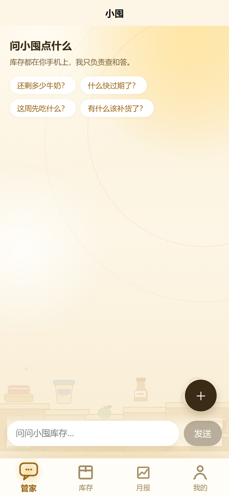

# 囤物有数 · Tunwu Youshu

> 本地优先的宿舍物品与临期管理 App。拍照入库、库存分类、临期提醒、月报，还有一个叫「小囤」的 AI 管家。

[](https://github.com/Carys-0312/tunwu-youshu/actions/workflows/ci.yml)

[uni-app](https://uniapp.dcloud.net.cn/) · Vue 3 · TypeScript · Pinia · Vite · Apache-2.0

App 用 uni-app（Vue 3）一套代码同时构建 **H5 与 Android**。库存、照片、批次和提醒默认只存在设备本机；只有拍照识别、AI 问答、月报润色和多设备同步需要后端。

> **本仓库只包含客户端。** 服务端（识别代理、AI 问答、账号与同步）不在此仓库中，详见下方「后端说明」。

## 截图

| 登录 | 管家 | 库存 |
| :---: | :---: | :---: |
|  |  |  |

| 月报 | 物品详情 | 我的 |
| :---: | :---: | :---: |
|  |  |  |

> 截图中的物品均为演示数据。

## 功能

- **拍照入库**：支持多张照片（正面 / 背面 / 日期特写），识别名称、分类、净含量、保质期和储存条件；识别失败可手动填写。
- **库存看板**：按饮品、水果、食品、冷冻、药品、日用品、调味等分类展示；单独汇总「库存偏低」，支持搜索和左滑删除。
- **物品详情**：批次、印刷到期日、生产日期、开封后使用期限（PAO）、热量和最近消耗；可一键用掉、补货或加入待购。
- **临期提醒**：按提前天数在 9:00 本地提醒，支持免打扰时段；Android 使用原生通知插件。
- **月报 / 年报**：消耗日历、消耗节奏、分类结构、到期分布，可导出长图；「小囤说」用 AI 生成一段补货建议（数字始终由本地计算）。
- **AI 管家「小囤」**：用自然语言查库存、问临期、要补货建议；名字和性格可自定义；提问时只上传当前库存快照，服务端不持久化物品数据。
- **账号与同步**（可选）：游客模式可用全部本地功能；登录后整份快照同步，多设备自动合并；支持邮箱验证码找回密码。
- **新手引导**：注册后认识小囤，首次进入逐项介绍核心功能。

## 技术栈

| 层 | 方案 |
| --- | --- |
| 框架 | uni-app（Vue 3 + TypeScript） |
| 状态管理 | Pinia |
| 构建 | Vite 5 |
| 本地存储 | App：SQLite；H5：IndexedDB（同一套表结构与仓储层） |
| 原生能力 | UTS 插件 `tunwu-notify`（Android 精确提醒 / iOS 本地通知） |
| 样式 | 原生 SCSS + rpx，自绘暖黄色主题 |

## 快速开始

### 环境要求

- Node.js **18+**（推荐 20 / 22）
- npm 9+
- 打包 Android / iOS 需要 [HBuilderX](https://www.dcloud.io/hbuilderx.html) 5.26+（仅云打包或真机运行时需要）

### 运行 H5

```bash
npm ci
npm run dev:h5
```

打开终端提示的地址（默认 `http://localhost:5173`）。

### 环境变量

后端地址通过 `VITE_API_BASE` 配置：

```bash
cp .env.example .env.development
```

- H5 不配置时会自动使用当前页面的 `hostname:8080`，方便本机联调。
- App 真机调试请填电脑的局域网 IP，例如 `http://192.168.1.10:8080`。
- 不连后端时，本地库存、分类、提醒、月报明细仍然可用；拍照识别、AI 问答、同步会提示不可用。

### 构建

```bash
npm run type-check   # TypeScript / Vue 类型检查
npm run build:h5     # 产物：dist/build/h5
npm run build:app    # 产物：dist/build/app，用 HBuilderX 导入后云打包
```

### 打包 Android

1. `npm run build:app`
2. HBuilderX 打开 `dist/build/app`
3. 在 `manifest.json` 中确认应用标识（见下方「已知限制」）
4. 发行 → 原生 App-云打包

## 后端说明

识别、管家、月报润色、账号与同步依赖一个 HTTP 后端。本仓库不包含服务端实现，接口约定可以从这些文件看到：

| 文件 | 用途 |
| --- | --- |
| `src/services/recognize.ts` | `POST /api/recognize`，多图 + 角色标记 |
| `src/services/assistant.ts` | `POST /api/assistant/chat`，库存快照 + 人设 |
| `src/services/auth.ts` | 注册、登录、找回密码、资料修改 |
| `src/services/sync.ts` | `/api/sync/**`，整份快照推拉 |
| `src/services/monthly-report.ts` | 月报润色 |

如果只需要本地功能，不配置 `VITE_API_BASE` 也能完整体验库存、提醒和月报。

## 数据与隐私

- 库存、照片、批次、消耗记录、提醒全部保存在本机：App 使用 SQLite，H5 使用 IndexedDB。
- 会联网的操作只有：拍照识别（上传照片到你自己配置的后端）、AI 问答（上传当前库存快照）、月报润色（上传本地生成的报告文本）、登录与同步。
- 本仓库不包含任何服务器地址、API Key、账号或密码。
- 仓库中的截图使用虚构的演示数据。

## 已知限制

- **后端不在仓库内**：需要自行实现或只使用本地功能。
- **DCloud appid**：`manifest.json` 中的 `__UNI__51C0929` 属于原作者账号。二次开发请在 HBuilderX 中重新获取自己的 appid，否则云打包会冲突。
- **Android 明文 HTTP**：`usesCleartextTraffic` 为 `true`，方便 HTTP 阶段调试；正式发布建议全站 HTTPS 后关闭。
- **本地提醒**依赖 App 进程存活；未接入 UniPush，App 被系统杀掉后可能收不到服务端推送。
- **PAO**（开封后使用期限）目前只有月粒度。
- 未包含自动化测试。

## 目录结构

```
.
├── src
│   ├── components        # 通用组件（管家对话、库存列表、功能引导、TabBar）
│   ├── composables       # 组合式函数
│   ├── constants         # 分类、性格预设
│   ├── db                # SQLite / IndexedDB 驱动、仓储层、schema
│   ├── pages             # 页面（登录、管家、库存、月报、我的…）
│   ├── services          # 业务服务（识别、问答、同步、提醒、报告、认证）
│   ├── static            # 图标、插画、字体
│   ├── stores            # Pinia
│   ├── types             # 数据模型与类型
│   ├── uni_modules       # UTS 原生通知插件
│   └── utils             # 日期、热量、图标、提醒策略
├── docs/screenshots      # README 截图
├── index.html
├── src/manifest.json
└── vite.config.ts
```

## 路线图

- [ ] 服务端参考实现与部署文档
- [ ] PAO 支持「天」粒度
- [ ] 自动化测试（日期、热量、提醒策略等纯函数）
- [ ] 服务端推送（UniPush）
- [ ] 英文界面

## 参与贡献

欢迎提 Issue 和 PR。提交前请确保：

```bash
npm run type-check
npm run build:h5
```

## License

[Apache License 2.0](LICENSE)，版权声明见 [NOTICE](NOTICE)。

Copyright 2026 囤物有数 contributors
